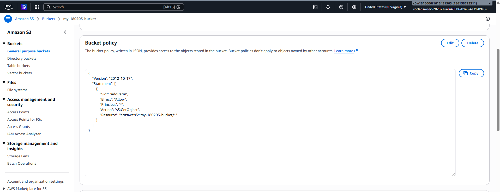
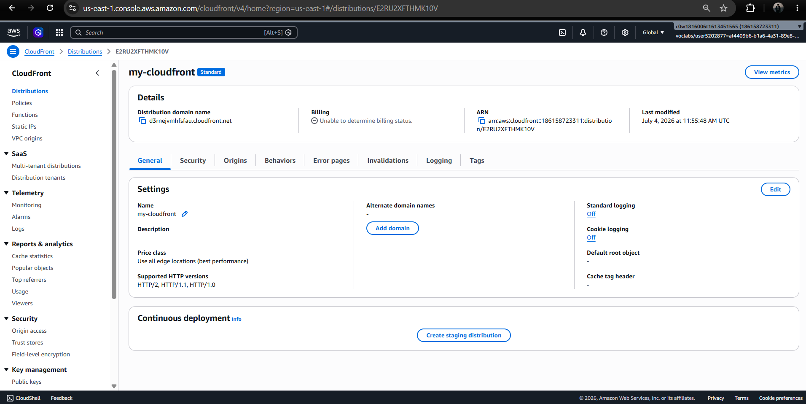
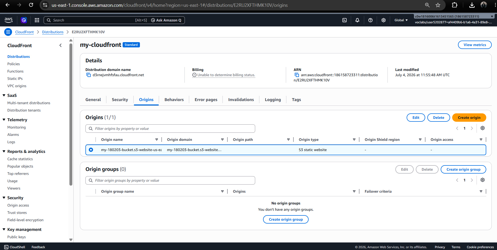
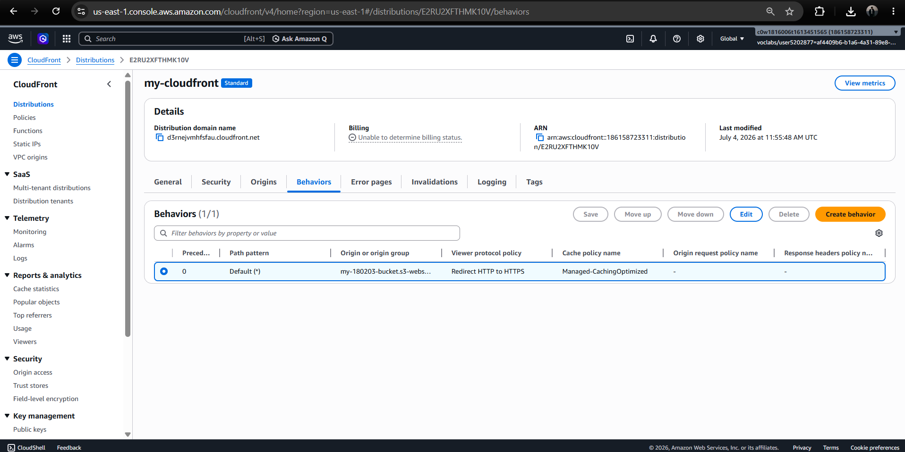
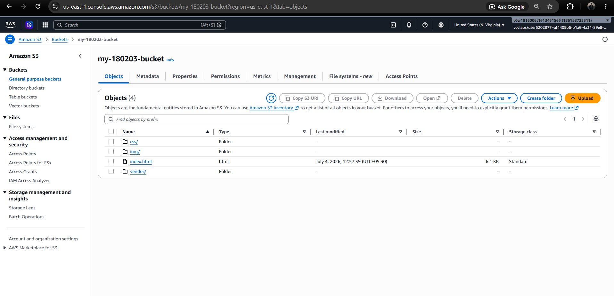

<div align="center">

```text
          .---.       .---.       .---.
       .-'     '-. .-'     '-. .-'     '-.
      /  .-----.  V  .-----.  V  .-----.  \
     |  |  S3   |----| EDGE  |----| WWW   |  |
      \  '-----'  ^  '-----'  ^  '-----'  /
       '-._____.-' '-._____.-' '-._____.-'
             \          |          /
              \_________|_________/
 
    ██████╗██╗      ██████╗ ██╗   ██╗██████╗
   ██╔════╝██║     ██╔═══██╗██║   ██║██╔══██╗
   ██║     ██║     ██║   ██║██║   ██║██║  ██║
   ██║     ██║     ██║   ██║██║   ██║██║  ██║
   ╚██████╗███████╗╚██████╔╝╚██████╔╝██████╔╝
    ╚═════╝╚══════╝ ╚═════╝  ╚═════╝ ╚═════╝
               S T A T I C   W E B
            S 3  ×  C L O U D F R O N T
```

# ☁️ CloudFront Static Website Deployment - ACCENTURE'S TRAINING PROJECT xoxoxoxox

[](https://aws.amazon.com/s3/)
[](https://aws.amazon.com/cloudfront/)
[](https://developer.mozilla.org/en-US/docs/Web/HTML)
[](https://developer.mozilla.org/en-US/docs/Web/CSS)

**A static website hosted on Amazon S3 and delivered globally through Amazon CloudFront.** This project demonstrates the core steps of publishing static site files to S3 and using a CDN distribution layer to serve them efficiently.

<div align="center">
  <a href="https://d3rnejvmhfsfau.cloudfront.net"><strong>🌐 View the live website</strong></a>
</div>

## Contents

- [Project overview](#-project-overview)
- [Architecture](#-architecture)
- [Live endpoints](#-live-endpoints)
- [Repository structure](#-repository-structure)
- [Deployment workflow](#-deployment-workflow)
- [Screenshots](#-screenshots)
- [Security considerations](#-security-considerations)
- [Technology stack](#-technology-stack)

## 🌟 Project overview

The repository contains a static website built with HTML and CSS, along with its supporting assets. The site is stored in an Amazon S3 bucket configured for website hosting, with an Amazon CloudFront distribution used as the public delivery layer.

The project illustrates a common cloud hosting pattern for static content:

- Store and serve site files from Amazon S3.
- Configure a CloudFront distribution with the S3 website endpoint as its origin.
- Deliver content to visitors through the CloudFront domain.
- Keep the website lightweight, with no application server required.

## 🧩 Architecture

```text
┌─────────────────┐       HTTPS        ┌────────────────────┐
│ Visitor's device│ ──────────────────▶ │ Amazon CloudFront  │
└─────────────────┘                    │  CDN / edge cache  │
                                        └─────────┬──────────┘
                                                  │ Origin request
                                                  ▼
                                        ┌────────────────────┐
                                        │ Amazon S3 website  │
                                        │ HTML, CSS, assets  │
                                        └────────────────────┘
```

CloudFront is the intended public entry point. The S3 website endpoint is configured as the origin in this setup.

## 🚀 Live endpoints

| Endpoint | URL | Purpose |
|---|---|---|
| CloudFront | [https://d3rnejvmhfsfau.cloudfront.net](https://d3rnejvmhfsfau.cloudfront.net) | Public site delivery endpoint |
| S3 website endpoint | [http://my-180203-bucket.s3-website-us-east-1.amazonaws.com/](http://my-180203-bucket.s3-website-us-east-1.amazonaws.com/) | S3 static website origin / direct testing |
| S3 object URL | [https://my-180203-bucket.s3.amazonaws.com/index.html](https://my-180203-bucket.s3.amazonaws.com/index.html) | Direct object reference |

> These are the endpoints documented for this project. Availability and configuration can change over time.

## 📁 Repository structure

```text
CloudFront_Static_Web_Deployment/
├── css/                         # Website stylesheets
├── img/                         # Website images
├── vendor/                      # Front-end libraries and assets
├── screenshots/                 # Additional project screenshots
├── index.html                   # Website entry page
├── README.md                    # Project documentation
├── README.txt                   # Deployment endpoint notes
├── S3_bucket.png                # S3 bucket configuration
├── Static Website Hosting.png   # S3 website hosting settings
├── Bucket_Policy.png            # Bucket policy screenshot
├── CloudFront.png               # CloudFront overview
├── CloudFront_Details.png       # Distribution details
├── CloudFront Distributions.png # Distribution listing
├── S3 Object.png                # S3 object view
├── S3 Website Endpoint.png      # Website endpoint view
├── my-180203-bucket_objects.png # Bucket objects view
├── my_cloudfront_behaviors.png  # Distribution behaviors
├── my_cloudfront_origins.png    # Distribution origins
└── README.md                   # Project documentation
```

## 🛠️ Deployment workflow

The deployment represented in this project follows these high-level steps:

1. Prepare the static site files, including `index.html`, stylesheets, and images.
2. Create an S3 bucket and upload the website files.
3. Enable static website hosting and specify the index document.
4. Configure the bucket access policy required by this website-origin setup.
5. Create a CloudFront distribution using the S3 website endpoint as the origin.
6. Test the deployed site through the CloudFront domain.

To preview the website locally, open `index.html` in a browser. For local testing over HTTP, run a simple static server from the repository root, for example:

```bash
python3 -m http.server 8000
```

Then visit `http://localhost:8000`.

## 📸 Deployment screenshots

The repository includes screenshots documenting the AWS setup:

<details>
<summary><strong>Amazon S3 setup</strong></summary>

#### Bucket configuration


#### Static website hosting


#### Bucket policy



</details>

<details>
<summary><strong>Amazon CloudFront setup</strong></summary>

#### Distribution overview and details




#### Origins and behaviors





</details>

<details>
<summary><strong>Website and S3 objects</strong></summary>




</details>

### Key deployment screenshots


## 🔐 Security considerations

This project uses an S3 **website endpoint** as the CloudFront origin. S3 website endpoints do not support HTTPS between CloudFront and the origin, and this deployment pattern may require public access to the bucket for the origin to work.

For a production-oriented private-origin design, consider using the S3 REST endpoint with CloudFront Origin Access Control (OAC), block public access to the bucket, and enable HTTPS viewer access for end users.

## 🧰 Technology stack

- **Amazon S3** — static website storage and hosting
- **Amazon CloudFront** — CDN and public delivery endpoint
- **HTML** — page structure
- **CSS** — presentation and styling

## 📄 License

No license is specified in this repository. Unless a license is added, reuse and redistribution may be restricted by default.

---

<div align="center">
  <sub>☁️ Static files in S3 · Cached and delivered by CloudFront · Built for the web</sub>
</div>
