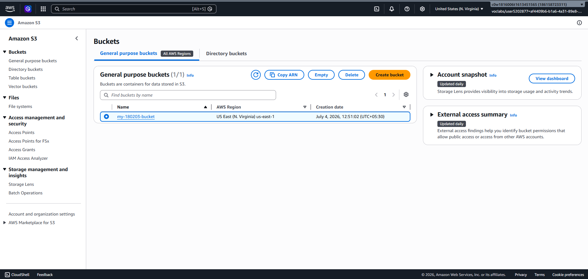

# ☁️ CloudFront Static Website Deployment

<div align="center">
  
  
  
</div>

A fully working demonstration of hosting a static website on Amazon S3 and distributing it globally through Amazon CloudFront. This project highlights a modern Cloud-native deployment pattern that is fast, scalable, cost-efficient, and production-ready for lightweight websites and landing pages.

## ✨ Overview

This repository contains a static website hosted from an S3 bucket and exposed through a CloudFront distribution. The architecture is optimized for static content delivery, where HTML, CSS, and images are served efficiently from an S3 origin while CloudFront caches content at edge locations for low latency and faster delivery worldwide.

This project demonstrates:

- Amazon S3 static website hosting
- Bucket policy configuration for public access
- CloudFront distribution setup
- Content distribution through edge locations
- Secure and performant global delivery of static content

---

## 🧩 Architecture

```text
                         ┌─────────────────────┐
                         │       User          │
                         │   Browser / Device  │
                         └──────────┬──────────┘
                                    │
                                    │ HTTPS
                                    ▼
                         ┌─────────────────────┐
                         │   Amazon CloudFront  │
                         │   Global Edge CDN    │
                         └──────────┬──────────┘
                                    │
                                    ▼
                         ┌─────────────────────┐
                         │  Amazon S3 Bucket   │
                         │  Static Website     │
                         │  Origin Files       │
                         └─────────────────────┘
```

```text
  ██████   ██████   ██████   ██████
  ██  ██   ██  ██   ██  ██   ██  ██
  ██  ██   ██  ██   ██  ██   ██  ██
  ██████   ██████   ██████   ██████
      │         │          │
      ▼         ▼          ▼
   [USER]   [CLOUD]   [S3]
```

---

## 🚀 Live Deployment

The static site is live and publicly accessible via the following endpoints:

- CloudFront URL: https://d3rnejvmhfsfau.cloudfront.net
- S3 Website Endpoint: http://my-180203-bucket.s3-website-us-east-1.amazonaws.com/
- S3 Object URL: https://my-180203-bucket.s3.amazonaws.com/index.html

> Note: The CloudFront URL is publicly accessible and works across devices. The S3 static website endpoint is used as the origin for CloudFront and is configured for browser-friendly website access.

---

## 📦 Project Structure

```text
CloudFront_Static_Web_Deployment/
├── css/
├── img/
├── vendor/
├── index.html
├── README.md
├── README.txt
├── S3_bucket.png
├── Static Website Hosting.png
├── Bucket_Policy.png
├── CloudFront.png
├── CloudFront_Details.png
├── CloudFront Distributions.png
├── S3 Object.png
├── S3 Website Endpoint.png
├── my-180203-bucket_objects.png
├── my_cloudfront_behaviors.png
├── my_cloudfront_origins.png
└── screenshots/
```

---

## 🛠️ What This Project Demonstrates

1. Create an S3 bucket for static website hosting.
2. Upload website assets such as HTML, CSS, and media files.
3. Enable S3 website hosting and configure the index document.
4. Apply a bucket policy to allow public read access.
5. Create a CloudFront distribution pointing to the S3 website endpoint.
6. Validate the site via the CloudFront domain and verify global CDN behavior.

---

## 📸 Screenshots

### S3 Bucket Configuration



### Static Website Hosting Setup


### Bucket Policy


### CloudFront Distribution


### CloudFront Details


### CloudFront Origins and Behaviors


### S3 Website Endpoint and Object


---

## 🧠 Why CloudFront + S3?

Using S3 for static content storage and CloudFront for content delivery provides several advantages:

- Low operational overhead
- High scalability for static traffic
- Reduced latency through distributed edge caches
- Improved performance for global users
- Simple and cost-effective hosting for website assets

This is an ideal pattern for:

- Personal portfolios
- Landing pages
- Product marketing sites
- Documentation pages
- Low-maintenance static business websites

---

## ✅ Deployment Flow Summary

```text
1. Upload static website files to S3
2. Enable website hosting on the bucket
3. Add public read bucket policy
4. Create CloudFront distribution
5. Set S3 website endpoint as origin
6. Access the site through CloudFront domain
```

---

## 🔐 Security and Notes

- Public access is enabled intentionally for a static website use-case.
- CloudFront acts as the primary public entry point for end users.
- S3 object and website endpoints are useful for testing and origin configuration verification.

---

## 📌 Technologies Used

- Amazon S3
- Amazon CloudFront
- HTML
- CSS
- Static Web Hosting

---

## 🏁 Final Thought

This project is a practical example of how to deploy a static website in AWS using a highly available and globally distributed content delivery model. It demonstrates a clean, scalable, and beginner-friendly Cloud deployment flow while reinforcing concepts important for real-world cloud architecture and DevOps workflows.

If you want, I can also create a more premium version of this README with:

- animated hero section badges
- a custom architecture diagram in SVG
- a project timeline section
- a more enterprise-style documentation format

---

<p align="center">
  <b>Built for fast, secure, and scalable cloud hosting</b>
</p>
